<picture>
  <source media="(prefers-color-scheme: dark)" srcset="assets/banner-dark.svg">
  
</picture>

  <a href="https://www.linkedin.com/in/leonard-lumati"><picture><source media="(prefers-color-scheme: dark)" srcset="assets/linkedin-dark.svg"></picture></a>&nbsp;
  <a href="mailto:leonardlumati99@gmail.com"><picture><source media="(prefers-color-scheme: dark)" srcset="assets/email-dark.svg"></picture></a>&nbsp;
  <a href="https://www.opassecure.com"><picture><source media="(prefers-color-scheme: dark)" srcset="assets/website-dark.svg"></picture></a>

I build and secure systems: hardening networks and servers, writing business software with security designed in, and responding when an attack gets through. I hold a BSc in Information Security and Forensics from KCA University and a Cisco CCNA.

## Now

- ICT Officer at the Kenya Marine and Fisheries Research Institute (KMFRI), since February 2026
- Founder of [OpasSecure](https://www.opassecure.com), a cybersecurity and IT services firm in Nairobi
- Volunteer Director of Finance and Administration at the Africa Innovation and Research Center, where I also oversee ICT

## Security work

### Incident response and assessment

- Found and removed web shells on compromised shared hosting and traced from the access logs when they had been used
- Reviewed a third-party GPS fleet-tracking platform and reported its configuration gaps, including alerts that notified no one
- Hardened systems to CIS Benchmarks and configured firewalls and IPsec VPNs for client networks

### Building secure systems

I build business systems for Kenyan organizations: ERP and SACCO lending platforms on Frappe and ERPNext, research repositories and journals on DSpace, OJS and Moodle, and web apps in Django, Laravel and PHP. Security goes in from the start.

- Role-based access and approval chains that separate duties, so staff can't approve their own requisitions or advances, and sensitive records such as medical claims are visible only to the people who handle them
- M-Pesa payment integrations with safeguards against double crediting and alerts for missed payments
- Authentication added to a clinic's patient API, and Python source exposure closed on a Django deployment on shared hosting
- Containerised deployments on VPSs behind Traefik, with nightly backups and DNSSEC on the mail domain

That code is in private repositories.

## Toolkit

| Area | Tools |
| --- | --- |
| Assessment | Nmap, Nessus, Burp Suite, Metasploit |
| Monitoring and forensics | Wireshark, Splunk |
| Networks | Cisco IOS, GNS3 |
| Systems | Kali Linux, Windows Server, Active Directory, VMware ESXi, Docker |
| Scripting | Python, PowerShell, Bash, SQL |

## Certifications

| Certification | Issuer | Year |
| --- | --- | --- |
| Cisco Certified Network Associate (CCNA), valid to December 2026 | Cisco | 2023 |
| ISO/IEC 27701:2025 Lead Auditor | Mastermind Assurance | 2026 |
| Cybersecurity (SWARA course) | AfricaHackon Academy | 2026 |
| Deep Web and Cybersecurity | EC-Council | 2023 |
